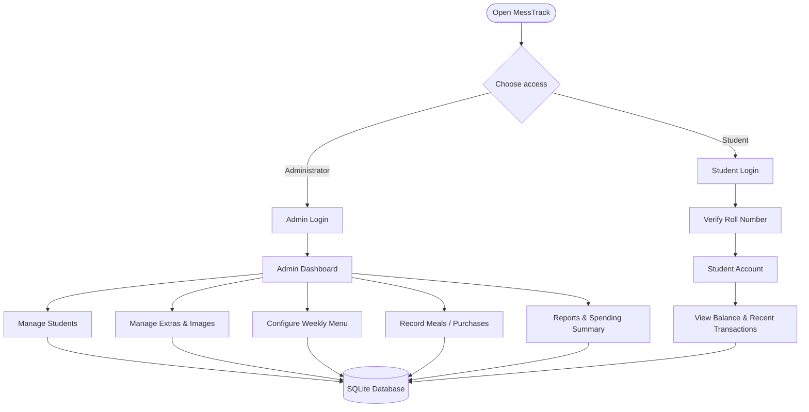
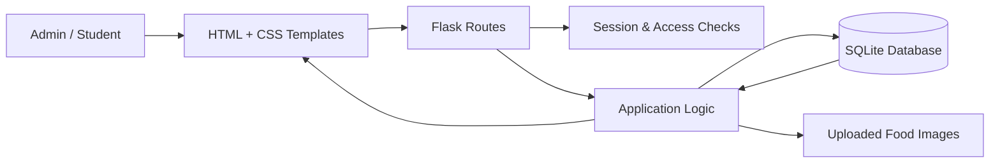
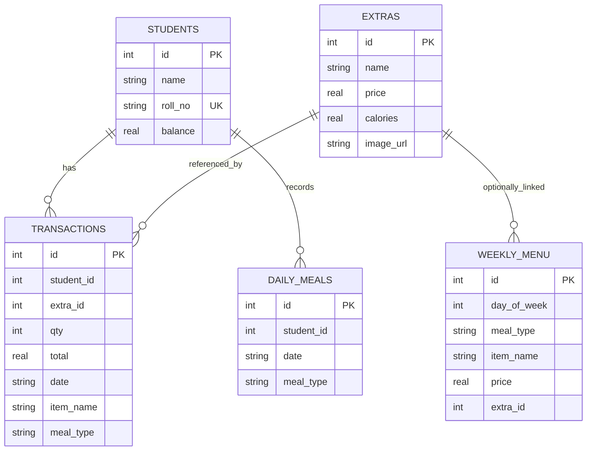

 
<div align="center">

# 🍽️ MessTrack
### Smart Mess Management & Student Billing System

**A Flask-powered web application for managing students, weekly menus, meal records, food extras, and mess transactions — all in one place.**

[](https://www.python.org/)
[](https://flask.palletsprojects.com/)
[](https://www.sqlite.org/)
[](https://developer.mozilla.org/en-US/docs/Web/HTML)
[](https://developer.mozilla.org/en-US/docs/Web/CSS)

**Designed to make everyday mess operations more organized, transparent, and manageable.**

</div>

---

## 📌 Overview

MessTrack is a web-based mess management system built with **Python, Flask, and SQLite**. It provides an organized way to maintain student accounts, configure a weekly food menu, record meals, manage additional food items, and track student spending.

Instead of maintaining separate manual records, administrators can use a single dashboard to manage mess activity. Students can sign in using their roll number and view their account balance and recent transaction history.

> **Project focus:** practical CRUD operations, role-based page access, relational data storage, session handling, and server-rendered web interfaces.

---

## ✨ Core Features

<table>
<tr>
<td width="50%">

### 🛡️ Admin Management
- Admin login and protected admin routes
- Add student records
- Add extra food items
- Upload food item images
- Record student purchases

</td>
<td width="50%">

### 🎓 Student Accounts
- Student login using roll number
- View personal account details
- Check current balance
- Review recent transactions
- View meal and purchase history

</td>
</tr>
<tr>
<td width="50%">

### 🗓️ Weekly Menu
- Configure menu by weekday
- Separate meal types
- Set item names and prices
- Link menu items to extra food records
- Remove menu entries

</td>
<td width="50%">

### 📊 Billing & Reports
- Automatically calculate purchase totals
- Update student balances after transactions
- Record daily meals
- View student spending summaries
- Display the highest-spending students

</td>
</tr>
</table>

---

## 🧭 Application Workflow



## 🏗️ Technical Architecture



| Layer | Technology | Responsibility |
|---|---|---|
| Presentation | HTML, CSS, Jinja templates | Pages, forms, tables, dashboard |
| Backend | Python, Flask | Routing, sessions, business logic |
| Database | SQLite | Students, menu, meals, extras, transactions |
| File handling | Werkzeug utilities | Secure filenames and image uploads |

---

## 🧰 Tech Stack

| Technology | Usage |
|:--|:--|
| **Python** | Main programming language |
| **Flask** | Web application framework |
| **SQLite** | Lightweight relational database |
| **HTML / Jinja2** | Dynamic server-rendered pages |
| **CSS** | Application styling |
| **Pillow** | Image-processing dependency |
| **Werkzeug** | Secure filename handling and password-hash verification |

---

## 🗂️ Project Structure

```text
oops-project/
│
├── app.py                         # Flask application and route handlers
├── db.py                          # SQLite connection and table initialization
├── database.db                    # Local SQLite database
├── requirements.txt               # Python dependencies
├── generate_admin_hash.py         # Admin password hash utility
├── migrate_menu.py                # Weekly-menu database migration
├── migrate_add_itemname_mealtype.py
├── RUN_INSTRUCTIONS.txt           # Run instructions
│
├── images/                        # Food image assets
│
├── static/
│   ├── style.css                  # Main stylesheet
│   ├── images/                    # Static image assets
│   └── uploads/                   # Uploaded food images
│
└── templates/
    ├── base.html                  # Shared page layout
    ├── dashboard.html             # Main dashboard
    ├── login.html                 # Admin login
    ├── student_login.html         # Student login
    ├── student.html               # Student account and history
    ├── add_student.html           # Add student form
    ├── add_extra.html             # Add extra item form
    ├── add_meal.html              # Record a meal
    ├── menu_add.html              # Add weekly menu item
    ├── menu_list.html             # View/manage weekly menu
    └── reports.html               # Spending reports
```

---

## ⚙️ Getting Started

### 1. Prerequisites

Make sure you have installed:

- Python 3
- pip
- Git (optional)

### 2. Clone the repository

```bash
git clone https://github.com/Ramssmb/oops-project.git
cd oops-project
```

### 3. Create and activate a virtual environment

**Windows PowerShell**

```powershell
python -m venv venv
.\venv\Scripts\Activate.ps1
```

**macOS / Linux**

```bash
python3 -m venv venv
source venv/bin/activate
```

### 4. Install dependencies

```bash
pip install -r requirements.txt
```

### 5. Start the application

```bash
python app.py
```

Open your browser and visit:

```text
http://127.0.0.1:5000
```

> The application initializes its SQLite tables when `app.py` starts. The included migration scripts are available for database schema updates where required.

---

## 🔐 Configuration & Security Notes

The application supports environment-based admin configuration:

| Variable | Purpose | Default |
|---|---|---|
| `FLASK_SECRET` | Flask session signing key | `dev_secret_change_me` |
| `ADMIN_USER` | Admin username | `admin` |
| `ADMIN_PASS` | Admin password when no hash is configured | `password123` |
| `ADMIN_PASS_HASH` | Werkzeug password hash; takes precedence over plain password | Not set |

**Before deploying or sharing a live instance:**

1. Set a unique, strong `FLASK_SECRET`.
2. Configure a strong admin password or `ADMIN_PASS_HASH`.
3. Do not commit real credentials, production database files, or private student data.
4. Run with debug mode disabled in production.
5. Use HTTPS and review authentication, authorization, and input validation before public deployment.

The defaults in the source are development fallbacks, **not production credentials**.

---

## 🗃️ Data Model



---

## 🧪 Main Modules

| Module | What it does |
|---|---|
| Authentication | Separates admin and student access using Flask sessions |
| Student management | Stores student name, roll number, and account balance |
| Extra item management | Stores item price, calories, and optional image |
| Transaction processing | Calculates quantity × price and updates student balance |
| Meal recording | Records meal attendance and applies the configured menu price when a matching menu entry exists |
| Weekly menu | Stores menu entries by weekday and meal type |
| Reports | Summarizes student balances and total spending |

---

## 🚀 Possible Future Improvements

- [ ] Add stronger student authentication (for example, password or OTP-based login)
- [ ] Add transaction filters by date, student, and meal type
- [ ] Add CSV / PDF report export
- [ ] Add low-balance alerts
- [ ] Add database backup and restore
- [ ] Add automated tests for billing and balance calculations
- [ ] Add deployment configuration and production server setup
- [ ] Improve validation and CSRF protection

---

## 🤝 Contributing

Contributions, suggestions, and bug reports are welcome.

1. Fork the repository.
2. Create a feature branch: `git checkout -b feature/your-feature`
3. Commit your changes: `git commit -m "Add: your feature"`
4. Push the branch: `git push origin feature/your-feature`
5. Open a Pull Request.

---

## 👨‍💻 Author

**Ramssmb**

- GitHub: [@Ramssmb](https://github.com/Ramssmb)
- Project: [oops-project](https://github.com/Ramssmb/oops-project)

---

<div align="center">

### Built to bring clarity to everyday mess management.

**If you find this project useful, consider giving the repository a ⭐**

</div>
